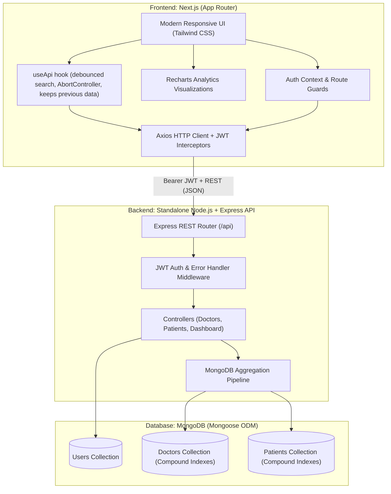
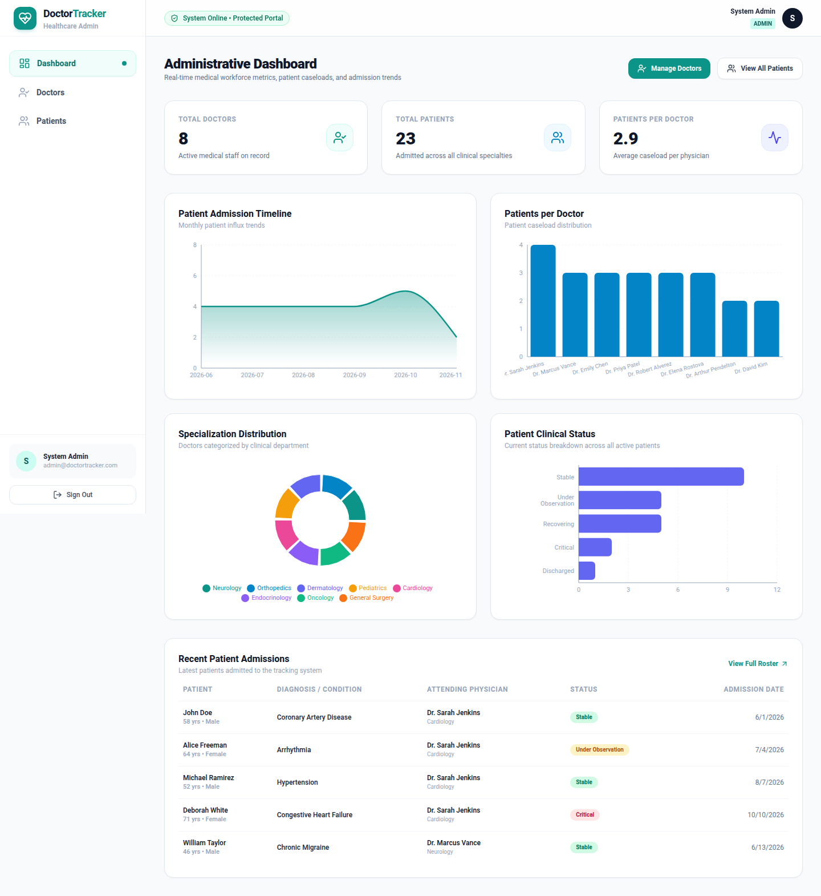
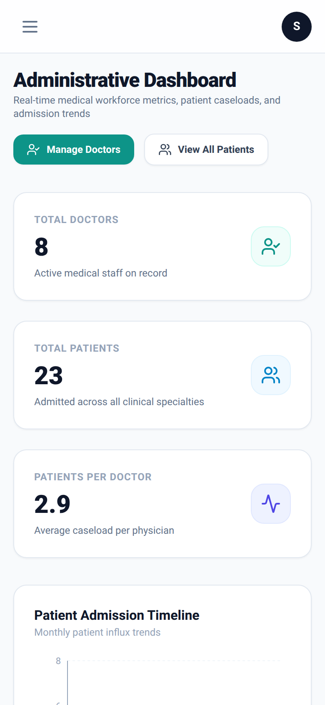
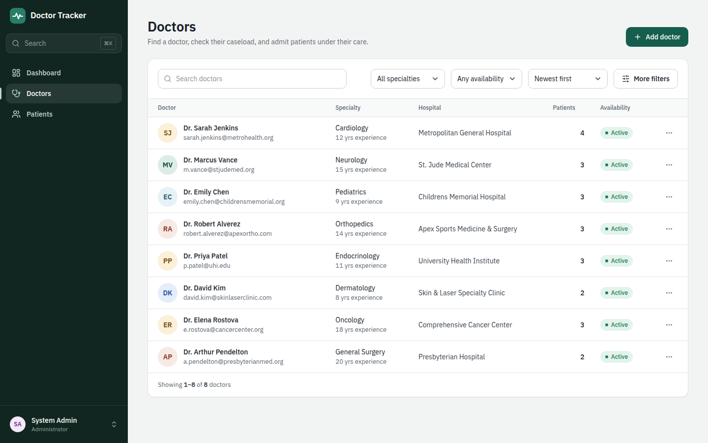
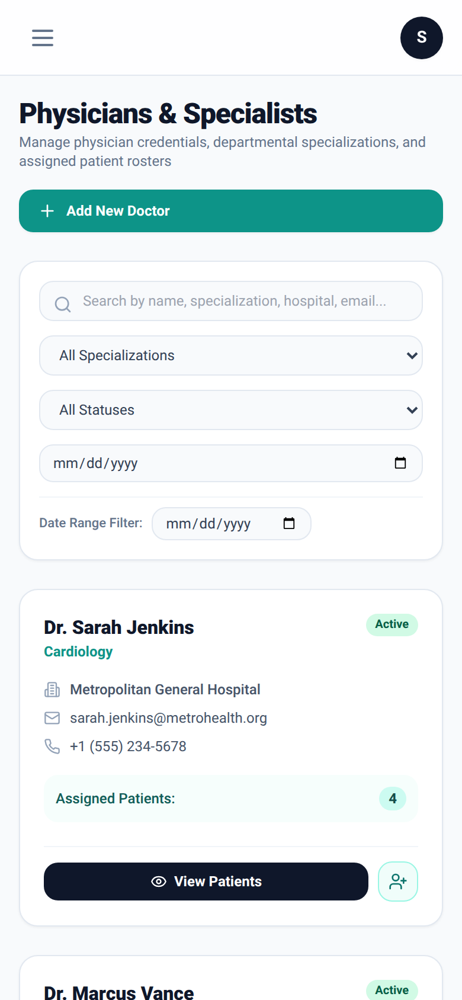
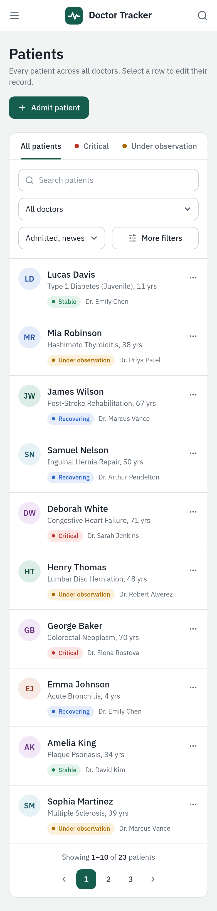
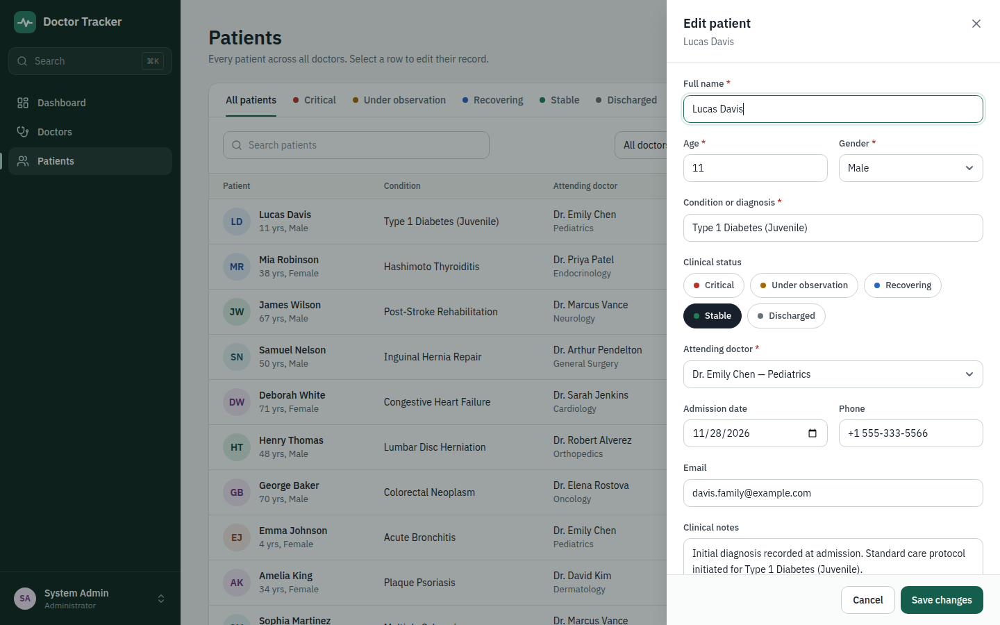
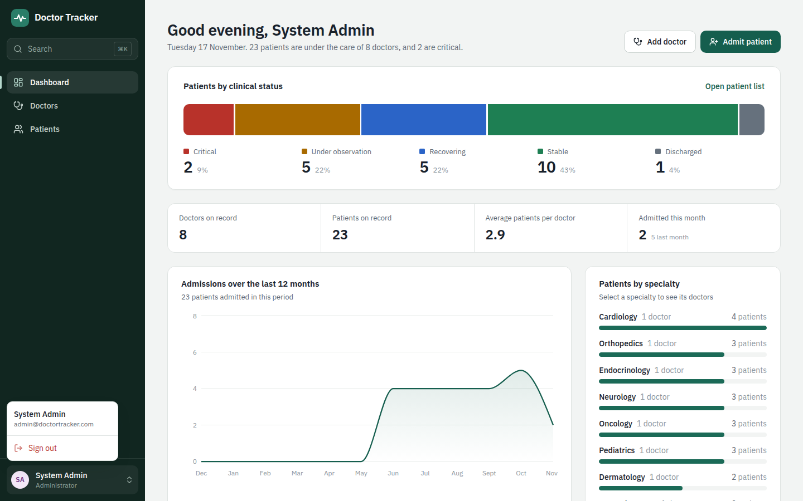
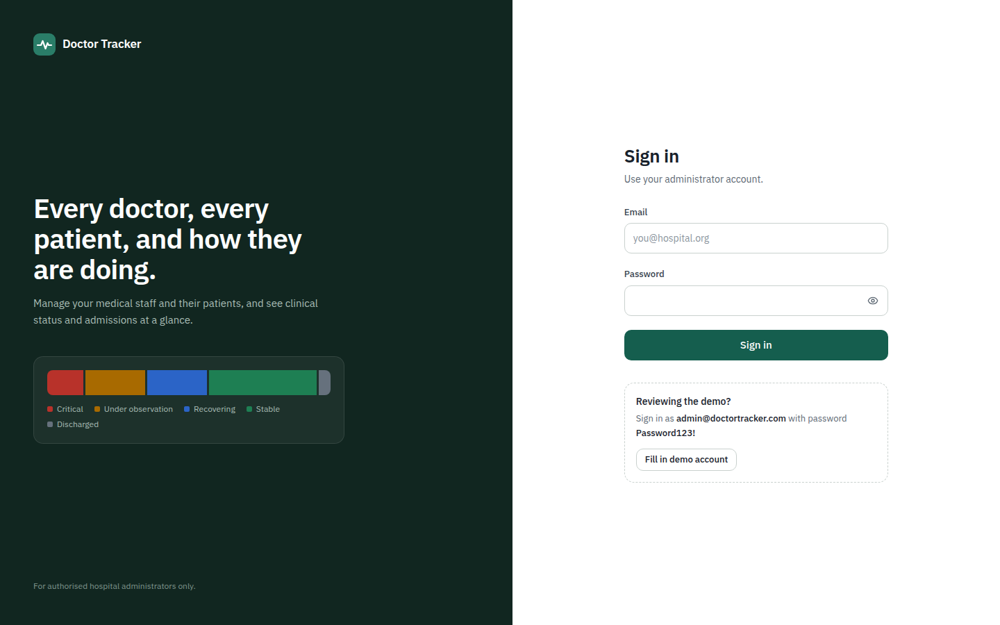
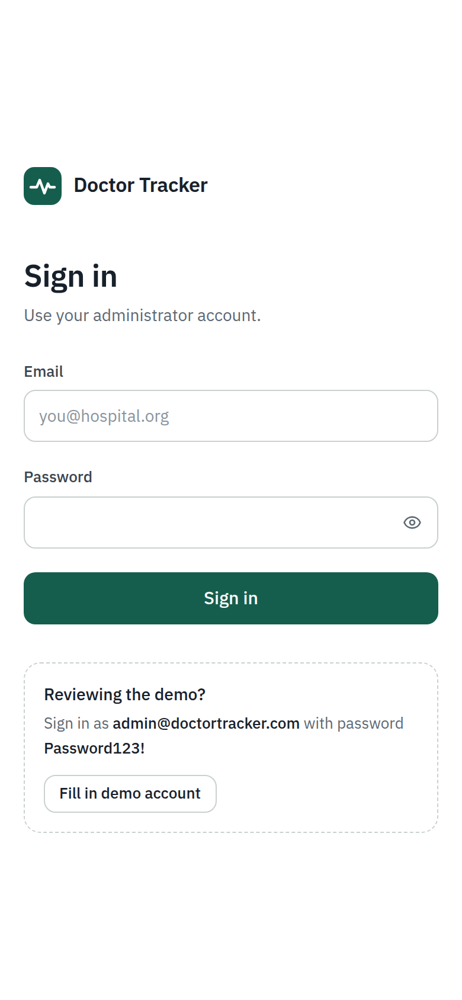

# Doctor Tracker — Healthcare Administrative Web Portal

**Live demo:** https://doctor-tracker-three-gamma.vercel.app  ·  **API:** https://doctor-tracker-api-tawny.vercel.app/health

### Demo Logins (Password for all: `Password123!`):
* **Administrator:** `admin@doctortracker.com` — Full system access, team management, caseload transfers, shifts & scheduling.
* **Doctor:** `doctor@doctortracker.com` — Scoped to Dr. Sarah Jenkins; views and admits only her assigned patients.
* **Nurse:** `nurse@doctortracker.com` — Clinical updates: updates status, notes, and follow-up schedules.

## 1. Description
Doctor Tracker is a secure admin portal for hospital administrators to manage doctors and the patients under their care: which doctor is treating whom, how many patients each doctor carries, and every patient's condition and clinical status. It pairs a Next.js frontend with a standalone Node.js/Express REST API on an indexed MongoDB database, and turns the data into a dashboard of caseloads, specialties, clinical status and admissions over time, with fast search, filtering and pagination throughout.

---

## 2. Setup Guide

Follow these steps to run the application locally on your machine.

### Prerequisites
* **Node.js**: v20.9 or higher (v22 recommended, see `.nvmrc`)
* **npm** or **pnpm**
* **MongoDB**: A local instance or a free MongoDB Atlas URI

### Step 1: Clone Repository
```bash
git clone <your-repository-url>
cd "Doctor Tracker"
```

### Step 2: Environment Configuration
Copy the `.env.example` templates to `.env` files for both server and client:

#### Backend Configuration (`server/.env`):
```bash
cp server/.env.example server/.env
```
Inside `server/.env`, ensure the following variables are set:
```env
PORT=5000
NODE_ENV=development
MONGODB_URI=mongodb+srv://<username>:<password>@cluster0.xxxxx.mongodb.net/doctor_tracker?retryWrites=true&w=majority
JWT_SECRET=your_super_secret_jwt_key_here
```

#### Frontend Configuration (`client/.env.local`):
```bash
cp client/.env.example client/.env.local
```
Inside `client/.env.local`:
```env
NEXT_PUBLIC_API_URL=http://localhost:5000/api
```

### Step 3: Install Dependencies
```bash
# Install Server dependencies
cd server && npm install

# Install Client dependencies
cd ../client && npm install
cd ..
```

### Step 4: Seed Database with Demo Records
Run the automated seeder script to populate MongoDB with default admin credentials, doctors across 8 clinical specialties, and patients with realistic multi-month timelines:
```bash
cd server && npm run seed
```
> **Default Admin Credentials Generated by Seeder:**
> * **Email:** `admin@doctortracker.com`
> * **Password:** `Password123!`

### Step 5: Start Development Servers
Open two terminal windows (or tabs):

**Terminal 1 — Express REST API (Port 5000):**
```bash
cd server && npm run dev
```

**Terminal 2 — Next.js Client (Port 3000):**
```bash
cd client && npm run dev
```

Open your browser at **`http://localhost:3000`** to log in and interact with Doctor Tracker.

---

## 3. System Architecture

Doctor Tracker adheres to strict separation of concerns with a standalone client-server architecture communicating over standard RESTful HTTP conventions with JSON data serialization.



### High-Level Data Flow:
1. **Authentication Flow:** User enters credentials on `/login`. The client transmits `POST /api/auth/login`. The Express server verifies passwords with bcrypt, issues a signed JSON Web Token (JWT), and the client keeps it in `localStorage` and React state (the trade-off versus cookies is explained under Security Notes). On load the session is re-checked with `GET /api/auth/me`; tokens expire after 12 hours.
2. **API Request Pipeline:** Axios automatically injects the `Authorization: Bearer <token>` header into all outbound requests. Pages fetch through one `useApi` hook: each list request is keyed by its query string, a newer request cancels the older one (AbortController), and the previous results stay on screen while the next page loads. A 401 response clears the session and the app routes to `/login`.
3. **Dashboard aggregation:** `GET /api/dashboard/stats` runs seven independent queries in parallel (`Promise.all`): document counts, `$group` + `$lookup` pipelines for patients per doctor and patients per specialty, a `$group` by month over the last 12 months of admissions (bounded with a `$match` on the indexed `admissionDate`), a status breakdown and the five latest admissions. All grouping happens inside MongoDB, so only the small summary rows reach Node.js.

---

## 4. Technical Decisions

### Decision 1: React Context API + Axios Interceptors over Redux Toolkit
* **Context:** The application requires global management of user authentication, route protection guards, and session persistence across views.
* **Why not Redux?** Redux introduces substantial boilerplate (slices, dispatchers, selectors, store providers) which increases client bundle size without providing tangible benefits for this application scope where server state is fetched declaratively with lightweight query parameters.
* **The Solution:** A small `AuthContext` holds only the session; Axios interceptors attach the token and report expiry. Server data is not copied into a global store at all: each page reads it through the `useApi` hook, keyed by the page's filters, so the URL-like query string is the single source of truth and there is nothing to keep in sync.
* **Trade-off:** no cross-page cache (revisiting a page refetches). With server-side pagination and indexed queries each request is small, so simplicity won over adding a cache library.

### Decision 2: Standalone Express Server vs. Next.js API Routes (Route Handlers)
* **Context:** The specification permits multiple architectures but strongly emphasizes a separate standalone backend service communicating via REST principles.
* **Decision:** We built an isolated `server/` running Express.js instead of hosting endpoints inside Next.js App Router Route Handlers.
* **Benefits:**
  1. **Deployment Flexibility:** The REST backend can be horizontally scaled, containerized, or hosted on distinct cloud compute nodes (e.g. VPS running PM2) independent of the frontend Next.js server or CDN.
  2. **Database Connection Persistence:** Standalone Node.js maintains stable, pooled Mongoose database connections without suffering from connection exhaustion common in serverless edge environments.
  3. **Performance Optimization:** Long-running analytics aggregations and seeder batch tasks execute in an isolated process that does not compete with Next.js page generation or SSR threads.

---

## UI design

* **Status colour is information, not decoration.** Five clinical-status colours are used only for patient status, so red always means critical. Everything else uses a calm pine and grey palette.
* **One place for the account.** The signed-in admin and *Sign out* live together in the sidebar account menu.
* **Fast navigation.** Ctrl/⌘ K opens a quick search across doctors and patients; dashboard figures link straight into the matching filtered list.
* **Forms never leave the list.** Create and edit happen in a side panel; deletes need confirmation; every save shows a short confirmation message.
* **Responsive.** Tables switch to cards under 768 px; no page scrolls sideways at 390 px. Keyboard focus is visible and reduced-motion preferences are respected.
* Typeface: IBM Plex Sans (self-hosted via `@fontsource`), with tabular figures for numbers.

---

## Performance & Optimization

**Database**
* Indexes match the real query shapes: `{specialization, createdAt}`, `{hospital, createdAt}`, `status`, `createdAt` and unique `email` on doctors; `{doctor, createdAt}`, `{condition, status}`, `admissionDate`, `status`, `createdAt` on patients. Duplicate and unused indexes were removed (`npm run sync-indexes`).
* Every list endpoint paginates on the server (`skip`/`limit`, max 100 per page) and runs the count and the page query in parallel. Sort fields are whitelisted.
* Search input is regex-escaped and capped at 100 characters, so user text can never become an expensive pattern.

**Frontend: avoiding unnecessary work and re-renders**
* Search boxes are debounced (300 ms), so typing sends one request per pause, not one per keystroke.
* Superseded requests are cancelled, and responses can never arrive out of order.
* Query strings are memoised (`useMemo`), so effects only re-run when a filter actually changes.
* Forms, drawers and the quick-search palette are mounted only while open, and the doctor list for the admit form is fetched only when that form opens.
* Previous results stay visible while the next page loads (no full-page spinners or layout jumps).
* The client is linted with React 19's hook rules (no state set synchronously inside effects, no refs read during render).

---

## 5. Visual Evidence

Screenshots are in [`docs/screenshots/`](docs/screenshots) (desktop 1440×900, mobile 390×844).

### Dashboard
| Desktop | Mobile |
|---|---|
|  |  |

The lead element is the clinical-status bar: every patient on one bar, split into Critical, Under observation, Recovering, Stable and Discharged. Each segment opens the patient list filtered to that status. Below it: key figures, admissions over the last 12 months, patients by specialty, caseload per doctor and recent admissions.

### Doctors
| Desktop | Mobile |
|---|---|
|  |  |

Search, specialty / availability / hospital / joined-date filters with removable filter chips, sorting, server-side pagination, add and edit doctors in a side panel, admit a patient under a doctor from the row menu.

### Doctor Profile & Patient Roster
| Desktop | Mobile |
|---|---|
|  |  |

### Patients
| Desktop | Mobile |
|---|---|
|  |  |

Status tabs, search, doctor / condition / admission-date filters, sorting and pagination. Select a row to edit in a side panel; delete asks for confirmation. Tables become cards on phones.

### Everyday interactions
| Edit in a side panel | Quick search (Ctrl/⌘ K) | Account menu |
|---|---|---|
|  |  |  |

### Login
| Desktop | Mobile |
|---|---|
|  |  |

---

## 6. Project Structure

```text
Doctor Tracker/
├── client/                              # Standalone Next.js Client
│   ├── src/
│   │   ├── app/
│   │   │   ├── globals.css              # Custom styling & scrollbar
│   │   │   ├── layout.jsx               # Root layout with AuthProvider, ToastProvider & AppShell
│   │   │   ├── page.jsx                 # Analytics Dashboard
│   │   │   ├── login/page.jsx           # JWT Login View
│   │   │   ├── doctors/
│   │   │   │   ├── page.jsx             # Doctors Roster with Filters & Search
│   │   │   │   └── [id]/page.jsx        # Doctor Detail & Patient Roster
│   │   │   ├── patients/
│   │   │   │   ├── page.jsx             # Patients View (Filters, Bulk Actions, Archive)
│   │   │   │   └── [id]/page.jsx        # Full Patient Record, History Timeline & Transfer
│   │   │   ├── schedule/page.jsx        # Duty Roster & Shifts (Day / Night / On-call)
│   │   │   └── team/page.jsx            # Team Accounts & Access Control (Admin)
│   │   ├── components/
│   │   │   ├── ui/                      # Drawer, ConfirmDialog, Menu, Toast, Pagination, StatusBadge, Avatar, …
│   │   │   ├── forms/                   # DoctorForm, PatientForm, TransferDialog (side panels)
│   │   │   ├── dashboard/               # WardStatus, AdmissionsChart (Recharts), BarList
│   │   │   ├── activity/                # ActivityList (timeline/feed), AlertsBell (critical alerts), describe
│   │   │   └── layout/                  # AppShell, Sidebar + account menu, CommandPalette, Logo
│   │   ├── context/                     # AuthContext with Route Guards
│   │   ├── hooks/                       # useApi (data fetching), useDebounce, useHydrated
│   │   └── lib/                         # Axios client instance, permissions, format, session
│   ├── .env.example
│   ├── package.json
│   └── tailwind.config.js
│
├── server/                              # Standalone Node.js Express REST API
│   ├── src/
│   │   ├── config/                      # MongoDB Connection logic
│   │   ├── controllers/                 # Auth, Doctor, Patient, Dashboard, Shift, Activity, Account Controllers
│   │   ├── middleware/                  # JWT auth guard, Role authorizer, Central error handler
│   │   ├── models/                      # User, Doctor, Patient, Activity, Shift Mongoose Schemas (Indexed)
│   │   ├── routes/                      # REST endpoints (/api/auth, /api/doctors, /api/patients, /api/dashboard, /api/shifts, /api/activity, /api/accounts)
│   │   ├── scripts/                     # seed.js (demo data), syncIndexes.js (align DB indexes)
│   │   ├── utils/                       # sanitize + validation helpers
│   │   ├── app.js                       # Express app (middleware + routes), importable by tests
│   │   └── server.js                    # Entry: env check, DB connect, listen
│   ├── tests/                           # API integration & feature tests (node:test)
│   ├── .env.example
│   └── package.json
│
├── qa/                                  # End-to-end automated browser QA
│   ├── browser-qa.mjs                   # 85-check Puppeteer headless suite
│   └── README.md                        # QA instructions & coverage guide
├── docs/screenshots/                    # README visual evidence
├── render.yaml                          # Render blueprint for the API
├── package.json                         # Root helper scripts
└── README.md                            # Primary Technical Documentation
```

---

## 7. Testing

### Backend Integration Tests (49 / 49 Passing)
```bash
cd server && npm test
```
49 integration and security regression tests (built-in `node:test`, no external test runner required) cover:
- Authentication & JWT issuance, password security, NoSQL-injection defense, route protection
- Roles & scoping: Administrator, Doctor (scoped to assigned patients), Nurse (status/notes/follow-up only)
- Patient transfer between doctors with reason logging; doctor deletion safeguards
- Follow-ups (overdue, today, upcoming) and length of stay calculations
- Shift management, overlap prevention, on-call queries
- Bulk actions, CSV export with formula injection sanitization, soft-archive and restore
- Doctor capacity meters and critical alerts tracking
- Security hardening: audit rollback on failure, post-transfer activity scoping, foreign doctor stats isolation, distributed rate-limit counters, 10 KB payload boundaries, and sanitized error logging (zero PHI in logs)
Tests execute against an isolated `doctor_tracker_test` database dropped immediately after completion.

### Browser QA Automation (85 / 85 Passing)
```bash
# In an external test runner directory:
node qa/browser-qa.mjs ./out
```
An automated Puppeteer suite verifies 85 real user flows in headless Chrome:
- Responsive layouts at 320px, 375px, 414px, 768px, 1024px, 1280px, 1920px (zero horizontal scroll)
- Form validation: client HTML5 checks + server error messaging for invalid emails, phones, and out-of-range values
- Security: Stored-XSS injection neutralization, NoSQL search tampering, URL manipulation
- Interactive UI: Quick search (`Ctrl/Cmd+K`), drawer panels, patient timeline events, live status badges, alert bells
- Network resiliency: API outage simulation with graceful error states and "Try again" recovery

---

## 8. Deployment

Both apps run on **Vercel** as two projects from this repository.

**API → Vercel project with Root Directory `server`**
* `server/api/index.js` wraps the Express app as a serverless function (MongoDB connection reused across warm invocations); `server/vercel.json` routes every path to it.
* Environment variables: `MONGODB_URI`, `JWT_SECRET` (64 random characters), `CLIENT_URL` (the frontend URL; comma-separate several).
* MongoDB Atlas → Network Access must allow `0.0.0.0/0` (Vercel functions have no fixed IP).

**Frontend → Vercel project with Root Directory `client`** (Next.js is detected automatically)
* Environment variables: `NEXT_PUBLIC_API_URL=https://<api-project>.vercel.app/api`, `NEXT_PUBLIC_SHOW_DEMO_LOGIN=true`.
* Optional `NEXT_PUBLIC_BASE_PATH` (e.g. `/doctor-tracker`) to serve the app under a sub-path of another domain.

`render.yaml` is kept as an alternative: the API also runs unchanged on Render (`npm start`).

**Demo login:** `admin@doctortracker.com` / `Password123!` (created by `npm run seed`).

---

## 9. Security Notes

* Only authenticated admins can use the API; public self-registration is disabled (admins create admins).
* JWT (HS256 only, 12 h expiry), bcrypt password hashing, timing-safe login, rate limiting on auth and API.
* Input validation on every write (type checks, enums, length caps, ObjectId checks), NoSQL operator / prototype-pollution stripping, HPP, Helmet, strict CORS in production.
* No-store cache headers on all API responses (patient data never cached), CSP and frame protection on the client.
* Request logs never include query strings (search terms can contain patient names).
* `/health` reports database connectivity (503 when the database is unreachable); graceful shutdown on SIGTERM.
* The demo seeder refuses to run against a production environment unless forced.
* CI runs lint, tests against MongoDB, the production build and `npm audit` on every push; Dependabot proposes updates weekly.
* Secrets live only in git-ignored `.env` files.
