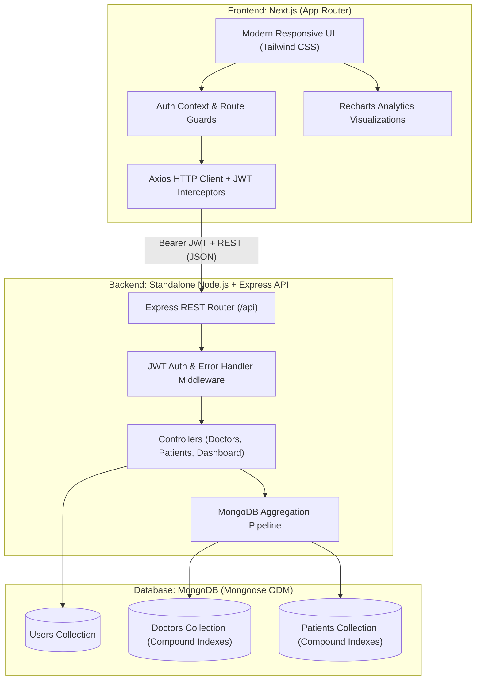
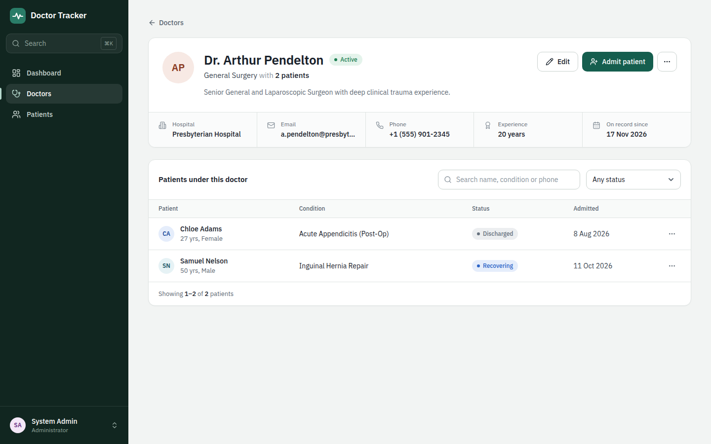
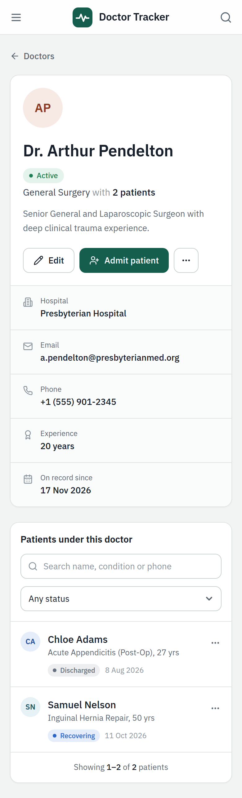
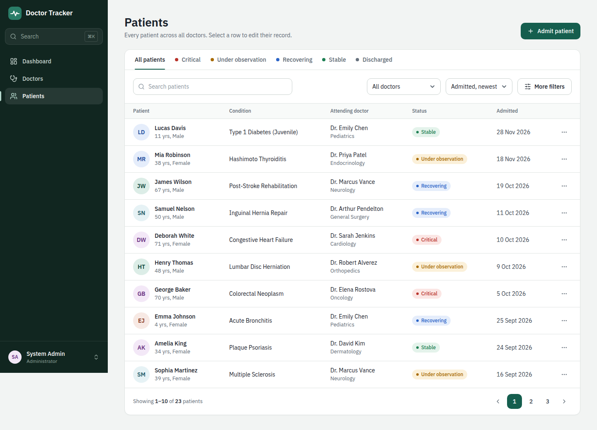
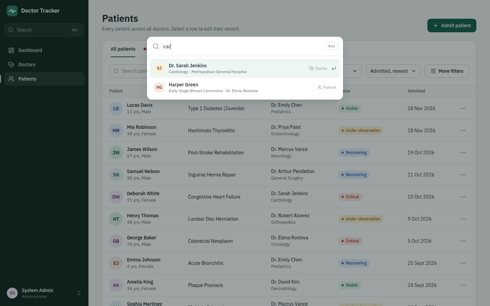

# Doctor Tracker — Healthcare Administrative Web Portal

## 1. Description
Doctor Tracker is a high-performance, full-stack healthcare administrative platform engineered to empower hospital operations with seamless physician workforce management, structured patient tracking, and real-time clinical analytics. Built with an decoupled architecture featuring a Next.js frontend client and a standalone Node.js/Express REST API backed by an indexed MongoDB cluster, Doctor Tracker delivers instantaneous search, multi-criteria filtering, and data aggregation to eliminate administrative overhead and enhance clinical visibility.

---

## 2. Setup Guide

Follow these steps to run the application locally on your machine.

### Prerequisites
* **Node.js**: v20.9 or higher (v22 recommended, see `.nvmrc`)
* **npm** or **pnpm**
* **MongoDB**: A local instance or a free MongoDB Atlas URI

### Step 1: Clone Repository
```bash
git clone <your-repository-url>
cd "Doctor Tracker"
```

### Step 2: Environment Configuration
Copy the `.env.example` templates to `.env` files for both server and client:

#### Backend Configuration (`server/.env`):
```bash
cp server/.env.example server/.env
```
Inside `server/.env`, ensure the following variables are set:
```env
PORT=5000
NODE_ENV=development
MONGODB_URI=mongodb+srv://<username>:<password>@cluster0.xxxxx.mongodb.net/doctor_tracker?retryWrites=true&w=majority
JWT_SECRET=your_super_secret_jwt_key_here
```

#### Frontend Configuration (`client/.env.local`):
```bash
cp client/.env.example client/.env.local
```
Inside `client/.env.local`:
```env
NEXT_PUBLIC_API_URL=http://localhost:5000/api
```

### Step 3: Install Dependencies
```bash
# Install Server dependencies
cd server && npm install

# Install Client dependencies
cd ../client && npm install
cd ..
```

### Step 4: Seed Database with Demo Records
Run the automated seeder script to populate MongoDB with default admin credentials, doctors across 8 clinical specialties, and patients with realistic multi-month timelines:
```bash
cd server && npm run seed
```
> **Default Admin Credentials Generated by Seeder:**
> * **Email:** `admin@doctortracker.com`
> * **Password:** `Password123!`

### Step 5: Start Development Servers
Open two terminal windows (or tabs):

**Terminal 1 — Express REST API (Port 5000):**
```bash
cd server && npm run dev
```

**Terminal 2 — Next.js Client (Port 3000):**
```bash
cd client && npm run dev
```

Open your browser at **`http://localhost:3000`** to log in and interact with Doctor Tracker.

---

## 3. System Architecture

Doctor Tracker adheres to strict separation of concerns with a standalone client-server architecture communicating over standard RESTful HTTP conventions with JSON data serialization.



### High-Level Data Flow:
1. **Authentication Flow:** User enters credentials on `/login`. The client transmits `POST /api/auth/login`. The Express server verifies passwords with bcrypt, issues a signed JSON Web Token (JWT), and the client stores it securely in `localStorage` while synchronizing React state.
2. **API Request Pipeline:** Axios automatically injects the `Authorization: Bearer <token>` header into all outbound requests. If an endpoint encounters a 401 Unauthorized status, the response interceptor seamlessly evicts the session and redirects the user to `/login`.
3. **Optimized Aggregations:** When accessing `/` (Dashboard), the server executes a single MongoDB `$facet` / aggregation pipeline computing doctor totals, patient caseloads, specialty distributions, and timeline series without loading redundant document sets into Node.js memory.

---

## 4. Technical Decisions

### Decision 1: React Context API + Axios Interceptors over Redux Toolkit
* **Context:** The application requires global management of user authentication, route protection guards, and session persistence across views.
* **Why not Redux?** Redux introduces substantial boilerplate (slices, dispatchers, selectors, store providers) which increases client bundle size without providing tangible benefits for this application scope where server state is fetched declaratively with lightweight query parameters.
* **The Solution:** We implemented a streamlined `AuthContext` coupled with Axios request/response interceptors. Token attachment, authorization expiry detection, and route guards are handled cleanly with minimal re-render overhead and zero third-party state library bloat.

### Decision 2: Standalone Express Server vs. Next.js API Routes (Route Handlers)
* **Context:** The specification permits multiple architectures but strongly emphasizes a separate standalone backend service communicating via REST principles.
* **Decision:** We built an isolated `server/` running Express.js instead of hosting endpoints inside Next.js App Router Route Handlers.
* **Benefits:**
  1. **Deployment Flexibility:** The REST backend can be horizontally scaled, containerized, or hosted on distinct cloud compute nodes (e.g. VPS running PM2) independent of the frontend Next.js server or CDN.
  2. **Database Connection Persistence:** Standalone Node.js maintains stable, pooled Mongoose database connections without suffering from connection exhaustion common in serverless edge environments.
  3. **Performance Optimization:** Long-running analytics aggregations and seeder batch tasks execute in an isolated process that does not compete with Next.js page generation or SSR threads.

---

## UI design

* **Status colour is information, not decoration.** Five clinical-status colours are used only for patient status, so red always means critical. Everything else uses a calm pine and grey palette.
* **One place for the account.** The signed-in admin and *Sign out* live together in the sidebar account menu.
* **Fast navigation.** Ctrl/⌘ K opens a quick search across doctors and patients; dashboard figures link straight into the matching filtered list.
* **Forms never leave the list.** Create and edit happen in a side panel; deletes need confirmation; every save shows a short confirmation message.
* **Responsive.** Tables switch to cards under 768 px; no page scrolls sideways at 390 px. Keyboard focus is visible and reduced-motion preferences are respected.
* Typeface: IBM Plex Sans (self-hosted via `@fontsource`), with tabular figures for numbers.

---

## 5. Visual Evidence

Screenshots are in [`docs/screenshots/`](docs/screenshots) (desktop 1440×900, mobile 390×844).

### Dashboard
| Desktop | Mobile |
|---|---|
|  |  |

The lead element is the clinical-status bar: every patient on one bar, split into Critical, Under observation, Recovering, Stable and Discharged. Each segment opens the patient list filtered to that status. Below it: key figures, admissions over the last 12 months, patients by specialty, caseload per doctor and recent admissions.

### Doctors
| Desktop | Mobile |
|---|---|
|  |  |

Search, specialty / availability / hospital / joined-date filters with removable filter chips, sorting, server-side pagination, add and edit doctors in a side panel, admit a patient under a doctor from the row menu.

### Doctor Profile & Patient Roster
| Desktop | Mobile |
|---|---|
|  |  |

### Patients
| Desktop | Mobile |
|---|---|
|  |  |

Status tabs, search, doctor / condition / admission-date filters, sorting and pagination. Select a row to edit in a side panel; delete asks for confirmation. Tables become cards on phones.

### Everyday interactions
| Edit in a side panel | Quick search (Ctrl/⌘ K) | Account menu |
|---|---|---|
|  |  |  |

### Login
| Desktop | Mobile |
|---|---|
|  |  |

---

## 6. Project Structure

```text
Doctor Tracker/
├── client/                              # Standalone Next.js Client
│   ├── src/
│   │   ├── app/
│   │   │   ├── globals.css              # Custom styling & scrollbar
│   │   │   ├── layout.jsx               # Root layout with AuthProvider & AppLayout
│   │   │   ├── page.jsx                 # Analytics Dashboard
│   │   │   ├── login/page.jsx           # JWT Login View
│   │   │   ├── doctors/
│   │   │   │   ├── page.jsx             # Doctors Roster with Filters & Search
│   │   │   │   └── [id]/page.jsx        # Doctor Detail & Patient Roster
│   │   │   └── patients/page.jsx        # Dedicated Patients View (Edit/Delete/Filter)
│   │   ├── components/
│   │   │   ├── ui/                      # Drawer, ConfirmDialog, Menu, Toast, Pagination, StatusBadge, Avatar, …
│   │   │   ├── forms/                   # DoctorForm, PatientForm (side-panel forms)
│   │   │   ├── dashboard/               # WardStatus, AdmissionsChart (Recharts), BarList
│   │   │   └── layout/                  # AppShell, Sidebar + account menu, CommandPalette, Logo
│   │   ├── context/                     # AuthContext with Route Guards
│   │   ├── hooks/                       # useDebounce (search inputs)
│   │   └── lib/                         # Axios client instance & interceptors
│   ├── .env.example
│   ├── package.json
│   └── tailwind.config.js
│
├── server/                              # Standalone Node.js Express REST API
│   ├── src/
│   │   ├── config/                      # MongoDB Connection logic
│   │   ├── controllers/                 # Auth, Doctor, Patient, Dashboard Controllers
│   │   ├── middleware/                  # JWT auth guard, Central error handler
│   │   ├── models/                      # User, Doctor, Patient Mongoose Schemas (Indexed)
│   │   ├── routes/                      # REST endpoints (/api/auth, /api/doctors, /api/patients, /api/dashboard)
│   │   ├── scripts/                     # seed.js (demo data), syncIndexes.js (align DB indexes)
│   │   ├── utils/                       # sanitize + validation helpers
│   │   ├── app.js                       # Express app (middleware + routes), importable by tests
│   │   └── server.js                    # Entry: env check, DB connect, listen
│   ├── tests/                           # API integration tests (node:test)
│   ├── .env.example
│   └── package.json
│
├── docs/screenshots/                    # README visual evidence
├── render.yaml                          # Render blueprint for the API
├── package.json                         # Root helper scripts
└── README.md                            # Primary Technical Documentation
```

---

## 7. Testing

```bash
cd server && npm test
```
15 integration tests (built-in `node:test`, no extra dependencies) cover login, closed public sign-up, NoSQL-injection rejection, doctor create / duplicate email / search / pagination, adding patients under a doctor, editing and filtering patients, delete rules, dashboard aggregation and ID validation. They run against an isolated `doctor_tracker_test` database on the same cluster, which is dropped afterwards.

---

## 8. Deployment

**Backend → Render (free tier)**
1. New → Blueprint → select this repo (uses [`render.yaml`](render.yaml); root `server/`, health check `/health`).
2. Set environment variables: `MONGODB_URI`, `JWT_SECRET` (64 random chars), `CLIENT_URL` (the Vercel URL, comma-separate several).
3. In MongoDB Atlas → Network Access, allow `0.0.0.0/0` (Render free has no static IP).
4. Note: the free instance sleeps after 15 minutes idle; the first request then takes about 30–50 seconds.

**Frontend → Vercel**
1. New Project → import this repo → Root Directory `client` (Next.js is auto-detected).
2. Environment variables: `NEXT_PUBLIC_API_URL=https://<render-service>.onrender.com/api`, optionally `NEXT_PUBLIC_SHOW_DEMO_LOGIN=true` so reviewers see the demo credentials.
3. Deploy, then put the Vercel URL into `CLIENT_URL` on Render.

**Demo login:** `admin@doctortracker.com` / `Password123!` (created by `npm run seed`).

---

## 9. Security Notes

* Only authenticated admins can use the API; public self-registration is disabled (admins create admins).
* JWT (HS256 only, 12 h expiry), bcrypt password hashing, timing-safe login, rate limiting on auth and API.
* Input validation on every write (type checks, enums, length caps, ObjectId checks), NoSQL operator / prototype-pollution stripping, HPP, Helmet, strict CORS in production.
* No-store cache headers on all API responses (patient data never cached), CSP and frame protection on the client.
* Secrets live only in git-ignored `.env` files.
