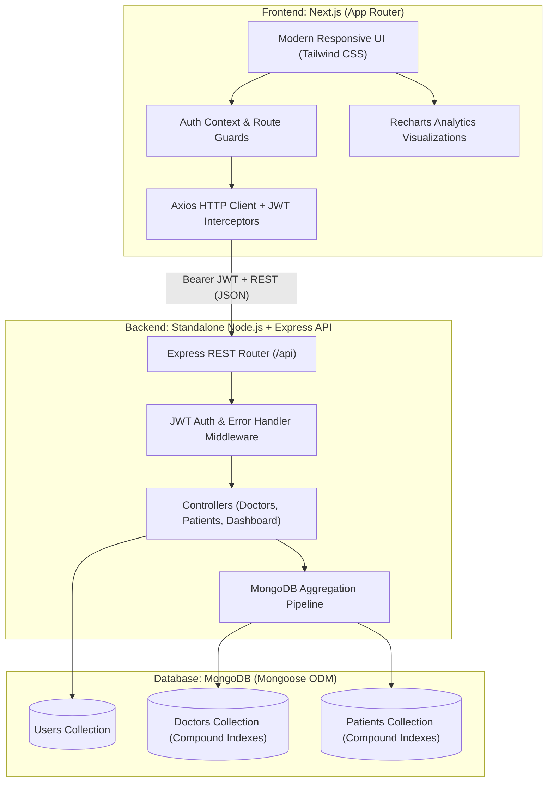

# Doctor Tracker — Healthcare Administrative Web Portal

## 1. Description
Doctor Tracker is a high-performance, full-stack healthcare administrative platform engineered to empower hospital operations with seamless physician workforce management, structured patient tracking, and real-time clinical analytics. Built with an decoupled architecture featuring a Next.js frontend client and a standalone Node.js/Express REST API backed by an indexed MongoDB cluster, Doctor Tracker delivers instantaneous search, multi-criteria filtering, and data aggregation to eliminate administrative overhead and enhance clinical visibility.

---

## 2. Setup Guide

Follow these steps to run the application locally on your machine.

### Prerequisites
* **Node.js**: v18.0.0 or higher (v20+ recommended)
* **npm** or **pnpm**
* **MongoDB**: A local instance or a free MongoDB Atlas URI

### Step 1: Clone Repository
```bash
git clone <your-repository-url>
cd "Doctor Tracker"
```

### Step 2: Environment Configuration
Copy the `.env.example` templates to `.env` files for both server and client:

#### Backend Configuration (`server/.env`):
```bash
cp server/.env.example server/.env
```
Inside `server/.env`, ensure the following variables are set:
```env
PORT=5000
NODE_ENV=development
MONGODB_URI=mongodb+srv://<username>:<password>@cluster0.xxxxx.mongodb.net/doctor_tracker?retryWrites=true&w=majority
JWT_SECRET=your_super_secret_jwt_key_here
```

#### Frontend Configuration (`client/.env.local`):
```bash
cp client/.env.example client/.env.local
```
Inside `client/.env.local`:
```env
NEXT_PUBLIC_API_URL=http://localhost:5000/api
```

### Step 3: Install Dependencies
```bash
# Install Server dependencies
cd server && npm install

# Install Client dependencies
cd ../client && npm install
cd ..
```

### Step 4: Seed Database with Demo Records
Run the automated seeder script to populate MongoDB with default admin credentials, doctors across 8 clinical specialties, and patients with realistic multi-month timelines:
```bash
cd server && npm run seed
```
> **Default Admin Credentials Generated by Seeder:**
> * **Email:** `admin@doctortracker.com`
> * **Password:** `Password123!`

### Step 5: Start Development Servers
Open two terminal windows (or tabs):

**Terminal 1 — Express REST API (Port 5000):**
```bash
cd server && npm run dev
```

**Terminal 2 — Next.js Client (Port 3000):**
```bash
cd client && npm run dev
```

Open your browser at **`http://localhost:3000`** to log in and interact with Doctor Tracker.

---

## 3. System Architecture

Doctor Tracker adheres to strict separation of concerns with a standalone client-server architecture communicating over standard RESTful HTTP conventions with JSON data serialization.



### High-Level Data Flow:
1. **Authentication Flow:** User enters credentials on `/login`. The client transmits `POST /api/auth/login`. The Express server verifies passwords with bcrypt, issues a signed JSON Web Token (JWT), and the client stores it securely in `localStorage` while synchronizing React state.
2. **API Request Pipeline:** Axios automatically injects the `Authorization: Bearer <token>` header into all outbound requests. If an endpoint encounters a 401 Unauthorized status, the response interceptor seamlessly evicts the session and redirects the user to `/login`.
3. **Optimized Aggregations:** When accessing `/` (Dashboard), the server executes a single MongoDB `$facet` / aggregation pipeline computing doctor totals, patient caseloads, specialty distributions, and timeline series without loading redundant document sets into Node.js memory.

---

## 4. Technical Decisions

### Decision 1: React Context API + Axios Interceptors over Redux Toolkit
* **Context:** The application requires global management of user authentication, route protection guards, and session persistence across views.
* **Why not Redux?** Redux introduces substantial boilerplate (slices, dispatchers, selectors, store providers) which increases client bundle size without providing tangible benefits for this application scope where server state is fetched declaratively with lightweight query parameters.
* **The Solution:** We implemented a streamlined `AuthContext` coupled with Axios request/response interceptors. Token attachment, authorization expiry detection, and route guards are handled cleanly with minimal re-render overhead and zero third-party state library bloat.

### Decision 2: Standalone Express Server vs. Next.js API Routes (Route Handlers)
* **Context:** The specification permits multiple architectures but strongly emphasizes a separate standalone backend service communicating via REST principles.
* **Decision:** We built an isolated `server/` running Express.js instead of hosting endpoints inside Next.js App Router Route Handlers.
* **Benefits:**
  1. **Deployment Flexibility:** The REST backend can be horizontally scaled, containerized, or hosted on distinct cloud compute nodes (e.g. VPS running PM2) independent of the frontend Next.js server or CDN.
  2. **Database Connection Persistence:** Standalone Node.js maintains stable, pooled Mongoose database connections without suffering from connection exhaustion common in serverless edge environments.
  3. **Performance Optimization:** Long-running analytics aggregations and seeder batch tasks execute in an isolated process that does not compete with Next.js page generation or SSR threads.

---

## 5. Visual Evidence

| View | Description | Key Features |
|---|---|---|
| **Administrative Dashboard** | Comprehensive analytics overview | KPI stat cards, Recharts admission timeline, patients-per-doctor caseload bar chart, specialty distribution pie chart, and recent admissions table. |
| **Doctors Management** | Physician roster directory | Multi-field search, specialty filter, status filter, date-range filter, server-side pagination, and 'Register New Doctor' modal. |
| **Doctor Profile & Roster** | Individual doctor detail page | Complete doctor profile, direct 'Admit Patient under Doctor' action, assigned patients table, and patient removal action. |
| **Dedicated Patients Page** | Global patient management | Full listing with condition search, diagnosis filter, status filter, attending physician filter, date range filter, Edit Patient modal, and Delete Patient confirmation modal. |
| **Secure Authentication** | Protected admin portal | JWT-secured login with demo credentials pre-fill helper and responsive medical layout. |

---

## 6. Project Structure

```text
Doctor Tracker/
├── client/                              # Standalone Next.js Client
│   ├── src/
│   │   ├── app/
│   │   │   ├── globals.css              # Custom styling & scrollbar
│   │   │   ├── layout.jsx               # Root layout with AuthProvider & AppLayout
│   │   │   ├── page.jsx                 # Analytics Dashboard
│   │   │   ├── login/page.jsx           # JWT Login View
│   │   │   ├── doctors/
│   │   │   │   ├── page.jsx             # Doctors Roster with Filters & Search
│   │   │   │   └── [id]/page.jsx        # Doctor Detail & Patient Roster
│   │   │   └── patients/page.jsx        # Dedicated Patients View (Edit/Delete/Filter)
│   │   ├── components/
│   │   │   ├── common/                  # Modal, Pagination
│   │   │   ├── dashboard/               # StatCard, AnalyticsCharts (Recharts)
│   │   │   └── layout/                  # Sidebar, Navbar, AppLayout
│   │   ├── context/                     # AuthContext with Route Guards
│   │   └── lib/                         # Axios client instance & interceptors
│   ├── .env.example
│   ├── .env.local
│   ├── package.json
│   └── tailwind.config.js
│
├── server/                              # Standalone Node.js Express REST API
│   ├── src/
│   │   ├── config/                      # MongoDB Connection logic
│   │   ├── controllers/                 # Auth, Doctor, Patient, Dashboard Controllers
│   │   ├── middleware/                  # JWT auth guard, Central error handler
│   │   ├── models/                      # User, Doctor, Patient Mongoose Schemas (Indexed)
│   │   ├── routes/                      # REST endpoints (/api/auth, /api/doctors, /api/patients, /api/dashboard)
│   │   ├── scripts/                     # seed.js (Admin, Doctors, Patients demo seeder)
│   │   └── server.js                    # Express application entry
│   ├── .env.example
│   ├── .env
│   └── package.json
│
├── resource/                            # Project Specification PDF
├── package.json                         # Root helper scripts
└── README.md                            # Primary Technical Documentation
```
